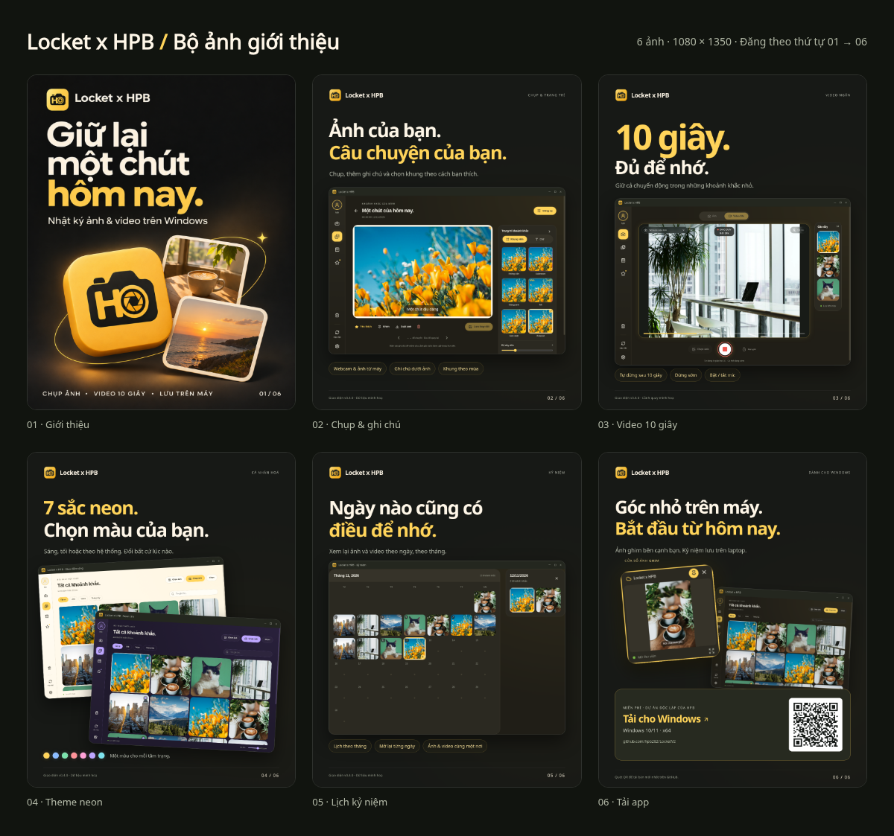

# Bộ ảnh giới thiệu Locket x HPB

6 ảnh PNG **1080 × 1350 px**, tỷ lệ **4:5**, tông vàng–đen. Đăng theo thứ tự 01 → 06 thành một bài nhiều ảnh.

**[Tải trọn bộ PNG và caption](https://github.com/hpb282/LocketV2/raw/refs/heads/main/docs/promo/Locket-x-HPB-bo-anh-gioi-thieu.zip)** · [Caption mẫu](CAPTION.md)

| Ảnh | Nội dung | Tệp PNG |
| --- | --- | --- |
| 01 | Giữ lại một chút hôm nay — giới thiệu sản phẩm | [Tải ảnh](png/01-gioi-thieu.png) |
| 02 | Chụp ảnh, nhập ảnh, ghi chú và khung trang trí | [Tải ảnh](png/02-chup-anh-va-ghi-chu.png) |
| 03 | Quay video tối đa 10 giây | [Tải ảnh](png/03-video-10-giay.png) |
| 04 | 7 màu neon, giao diện sáng/tối | [Tải ảnh](png/04-theme-neon.png) |
| 05 | Lịch kỷ niệm theo ngày, tháng | [Tải ảnh](png/05-lich-ky-niem.png) |
| 06 | Ảnh ghim trên desktop và QR tải app | [Tải ảnh](png/06-tai-app-cho-windows.png) |

QR ở ảnh 06 dẫn đến [GitHub Releases bản mới nhất](https://github.com/hpb282/LocketV2/releases/latest), dùng được sau khi phát hành phiên bản mới.

Ảnh bìa là minh hoạ AI dựa trên icon của dự án. Các ảnh 02–06 sử dụng màn hình chụp từ app Electron **v0.4.0** thật với thư viện demo cô lập; cảnh quay dùng nguồn webcam giả lập. Xem [nguồn ảnh](NGUON-ANH.txt) và [hướng dẫn sử dụng](HUONG-DAN.txt).

Tạo ngày **12/11/2026**. Đã kiểm tra kích thước PNG, giải mã QR và tính toàn vẹn của gói ZIP.
